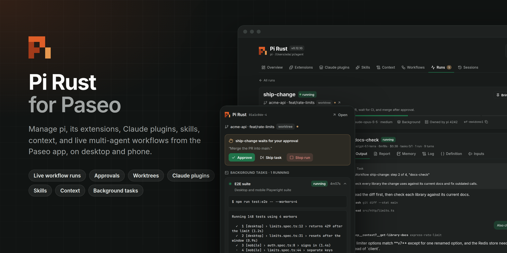
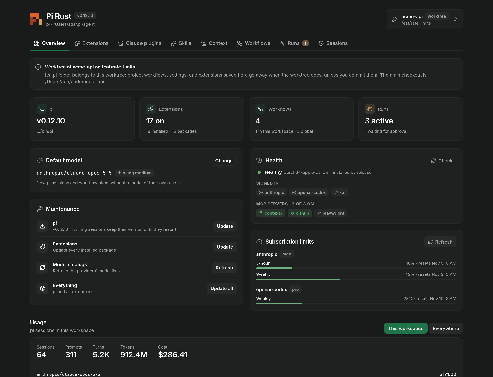
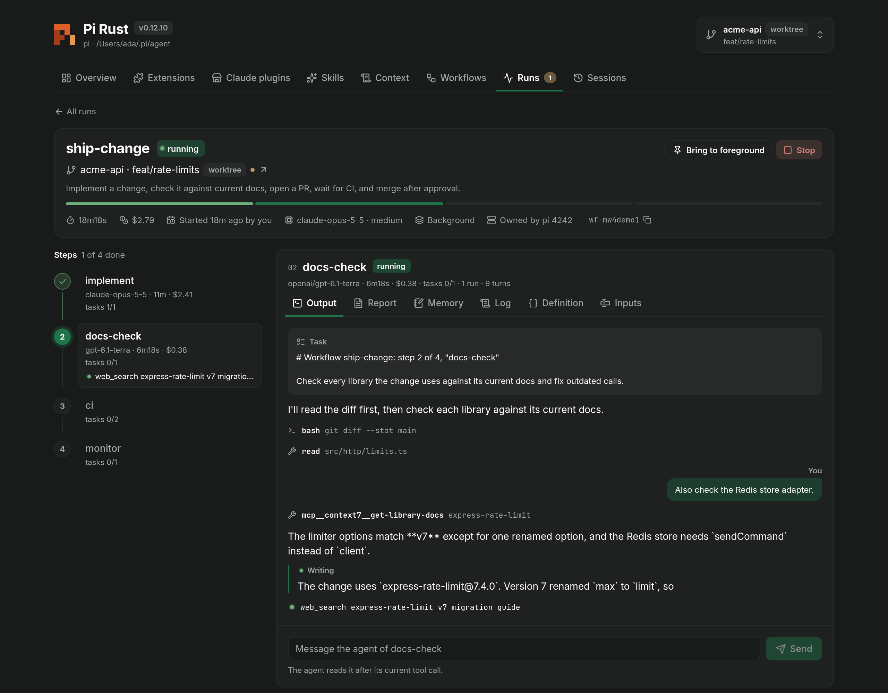
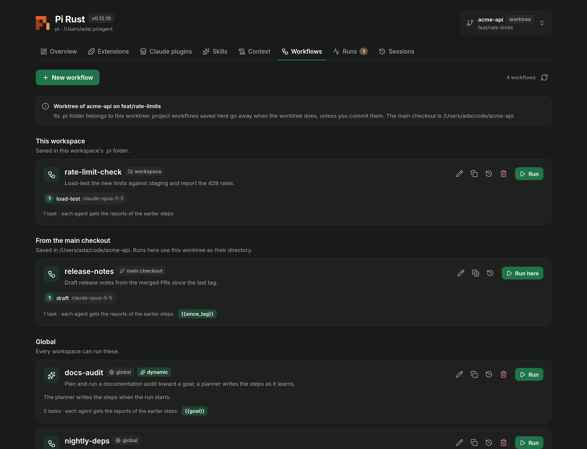
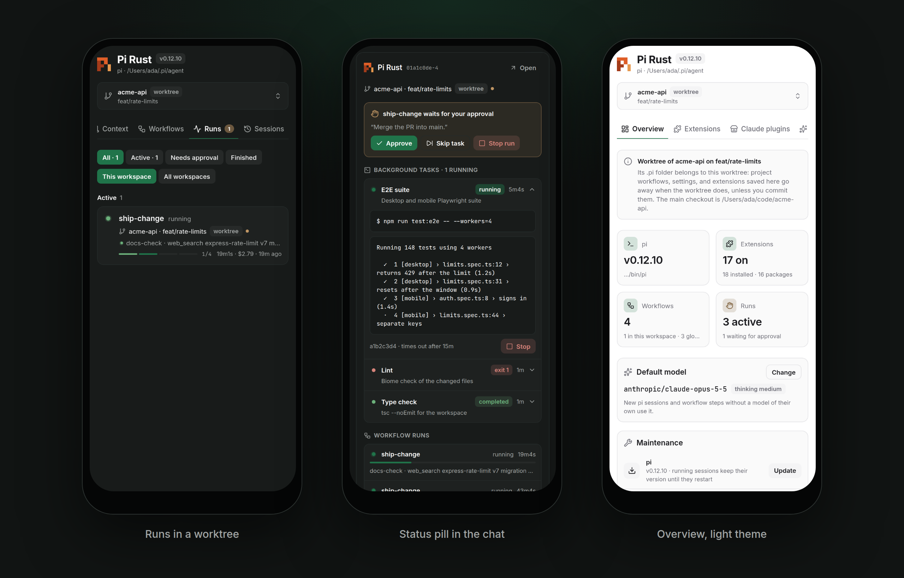
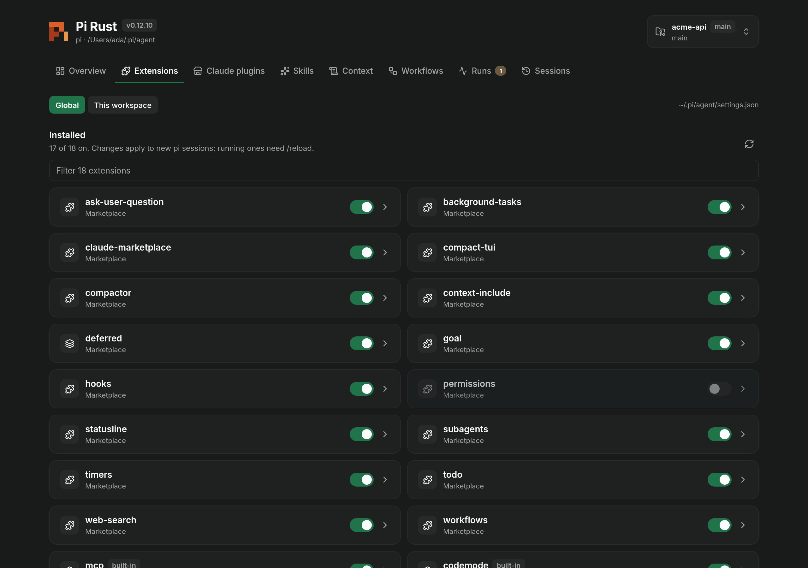
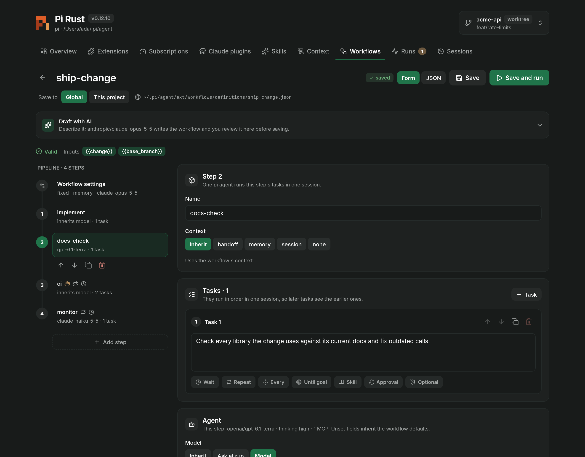
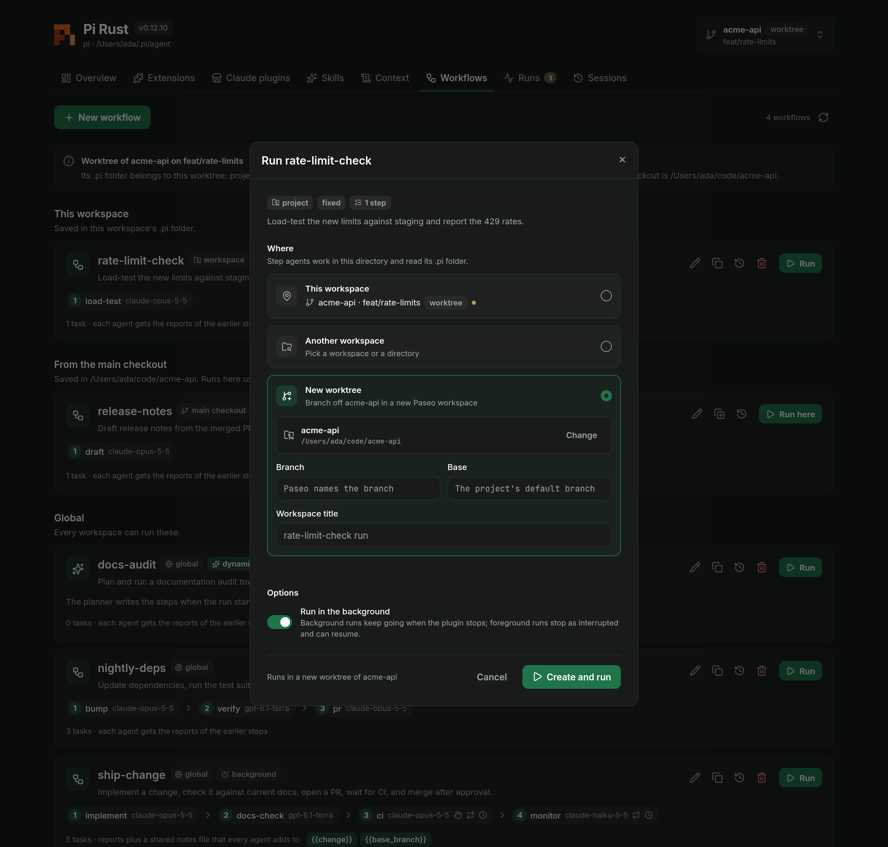
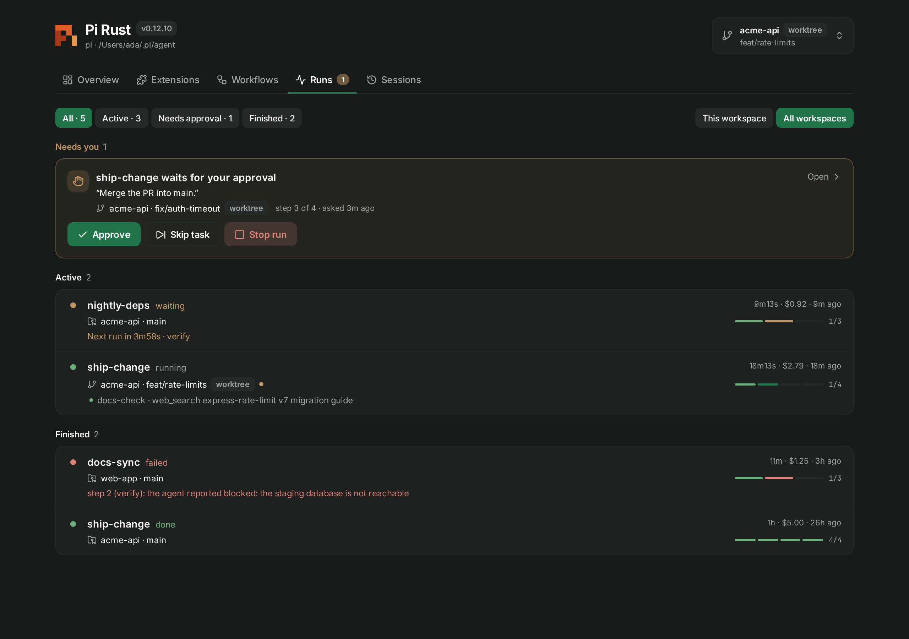
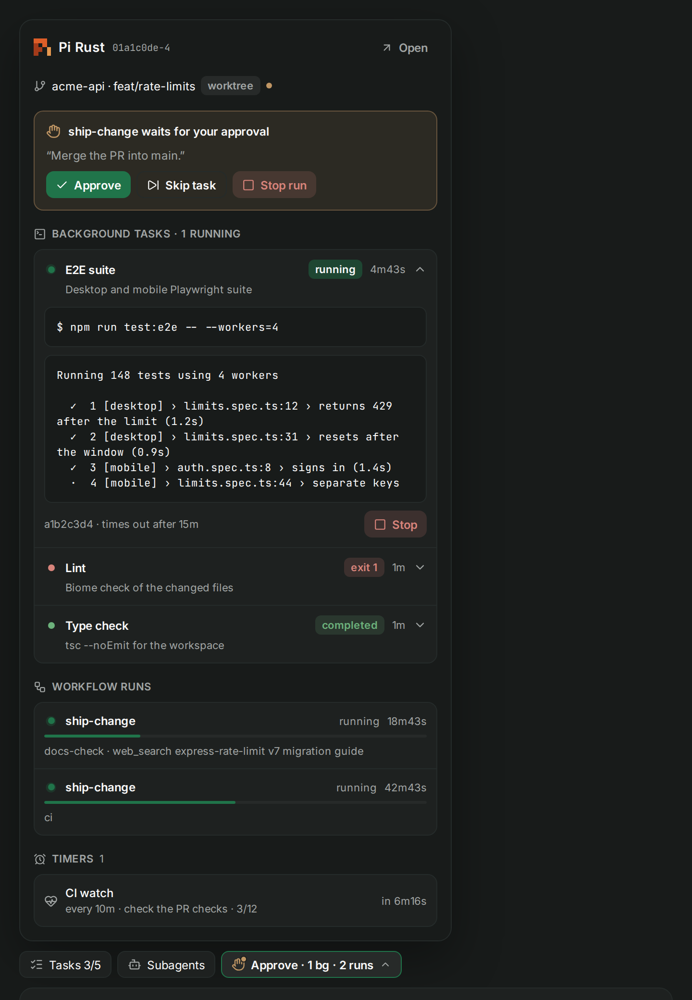

# Pi Rust for Paseo

A [Paseo](https://paseo.sh) plugin for [Pi Rust](https://github.com/yannelli/pi-rust). It manages pi, its extensions, and the multi-agent workflows of the `workflows` extension from the Paseo app, on desktop and on a phone. It works on the same files and commands as pi, so a change in Paseo and a change in pi's own TUI are the same change.

- See pi's version, health, default model, subscription limits, and usage. Update pi, extensions, and model catalogs.
- Turn extensions on and off, update or remove packages, and install from the marketplace, npm, Git, or a path, globally or for one workspace.
- Create, edit, copy, and delete workflows in a form or as JSON, with the same validation as pi. A model can draft one from a description.
- Start a run in the current workspace, another workspace, or a new worktree. Watch it live: the step timeline, the agent's output as it writes, reports, and memory.
- Approve or skip a task that waits, end a wait, message the working agent, stop, resume, and delete runs.
- See each agent's background tasks, runs, goal, and timers in a pill in its composer.
- Give Paseo agents tools to run workflows and manage extensions.









The images show sample data. [CONTRIBUTING.md](CONTRIBUTING.md#screenshots) explains how to render them again.

## What you need

- Paseo 0.15.0 or newer, with **Enable plugins** turned on in **Settings → Plugins**.
- [Pi Rust](https://github.com/yannelli/pi-rust) on the machine that runs the Paseo daemon.
- For workflows, the `workflows` extension: `pi install marketplace:workflows`, or install it from the plugin's Extensions tab. The status pill also reads the `background-tasks`, `goal`, and `timers` extensions when they are installed.

## Install

```sh
paseo plugin add github:yannelli/pi-rust-paseo
paseo plugin ls pi-rust
```

To pin a release, add `--ref` and a tag, for example `--ref v0.1.1`. Plugins run trusted code with the daemon user's access.

The plugin finds pi through its settings, then `$PI_BIN`, then `pi` on the daemon's `PATH`, `~/.local/bin`, or `~/.cargo/bin`. It reads `~/.pi/agent` unless `PI_CODING_AGENT_DIR` or the plugin settings name another directory.

## Use

Open **Pi Rust** from the sidebar or the Command Center (**⌘K**). The workspace picker at the top chooses the project that project settings, extensions, workflows, and sessions refer to; it lists Paseo workspaces by project and branch and remembers your choice.

### Overview

Tiles show pi's version, the extensions that are on, the workflows, and the runs. Below them you can change the default model (**Use claude-opus-5-5 · medium** sets the recommended one), update pi, extensions, or model catalogs, run `pi doctor`, check subscription limits, and read usage by model. **settings.json** edits pi's global or workspace settings.

### Extensions

Switch built-in and installed extensions on or off, update or remove packages, search the marketplace, and install from `npm:`, `git:`, a URL, or a path. **Global** changes `~/.pi/agent/settings.json`; **This workspace** changes the workspace's `.pi/settings.json`. Running pi sessions pick up changes on `/reload`.



### Workflows

Each workflow shows as a pipeline: its steps, their models, and markers for approvals, loops, and waits. The editor covers every field of the format: models (or **Ask at run**), thinking, tools, skills, MCP servers, subagent rules, environment, limits, and the task options for waits, repeats, goals, approvals, and skills. New workflows start with `anthropic/claude-opus-5-5` at medium thinking.



In a worktree, the tab also lists the workflows saved in the main checkout and runs them in the worktree. The plugin says when a directory is a worktree, whose `.pi` files go away with it unless you commit them, and when pi does not trust a directory and so ignores its `.pi` folder.

### Runs

**Run** asks for the `{{inputs}}`, for models marked **Ask at run**, and where to run: this workspace, another workspace, or a new worktree that Paseo creates. Runs that wait for you come first in the Runs tab. A run's view follows the working step, streams the agent's output, and takes a message for the agent.





### Status in the chat

Each pi agent's composer has a **Pi Rust** pill next to Tasks and Subagents; other agents get it while a run is active in their workspace. The label sums up the agent's work, such as `Approve · 1 bg · 2 runs`. The popover shows approvals, the background tasks of the agent's pi session with their output, workflow runs, the workspace's goal, and timers, and refreshes every second or two.



### Composer and agents

- `/workflow run <name> key=value` starts a run and adds a live card to the agent's timeline; `--worktree[=branch]` runs it in a new worktree. `/workflow approve`, `stop`, `resume`, and `skip` control runs.
- `/pi-ext install|remove|enable|disable|update <source> [-l]` manages extensions.
- Paseo agents get the `pi_workflows` and `pi_extensions` tools. An agent that starts a run gets the step reports as a message when the run ends. The tools cannot approve tasks.

## Settings

**Settings → Plugins → Pi Rust**:

| Setting | Default | What it does |
| --- | --- | --- |
| pi binary | `$PI_BIN`, then `PATH` | The pi executable. |
| Agent directory | `$PI_CODING_AGENT_DIR`, then `~/.pi/agent` | pi's settings, extensions, and workflow files. |
| Workflow runner | The installed `workflows` extension | The `pi-rust-ext` binary that runs workflows. |
| Run in the background by default | On | Background runs keep going when the plugin stops. Foreground runs stop as interrupted and can resume. |
| Report run ends to the agent | On | Sends the step reports to the agent that started a run. |
| Agents with the tools | Every agent | Every agent, every agent except pi agents (they have the `workflow` tool), or none. |

## Data and permissions

The plugin runs `pi` and `git` on the daemon machine. It reads and writes pi's settings, workflow definitions, run directories, and session files, reads the state files of the `background-tasks`, `goal`, and `timers` extensions, starts the workflows runner as a detached process, and signals a background task's process group when you stop it. It creates Paseo worktrees only when you ask for one. Updates and installs download from the Pi Rust releases, the extension marketplace, npm, or Git, as `pi` does. The plugin sends nothing anywhere else.

Project workflows and settings follow pi's project trust: the plugin does not save project workflows where pi does not trust the directory.

## How it works

The plugin starts runs the way pi does. It writes `run.json` in `<agentDir>/ext/workflows/runs/<id>/` and starts `pi-rust-ext workflows --runner <dir>` detached, so runs outlive the plugin. Commands to a runner (`stop`, `skip`, `approve`, `mode`, `interrupt`) are JSON files in the run's `commands/` folder, and messages to the working agent are JSON strings in `inbox/`. The plugin keeps `sessions/<pid>` fresh, so a foreground run stops when the plugin stops, as it does when pi quits.

The skill catalog comes from `pi --mode rpc` with `PI_WORKFLOW_RUN` set, so that pi does not watch or report runs. A Paseo pi agent's persistence session id is its pi session id; the status pill uses it to find the agent's background tasks and timers.

| Path | Contents |
| --- | --- |
| `shared/` | The workflow format and its validation (matching `extensions/workflows/src/model.rs`), run and status types, and RPC contracts |
| `server/` | pi commands, workflow files, the runner protocol, status readers, agent tools |
| `client/` | The Pi Rust screen, the Workflows panel, the run card, the status pill, and settings |
| `test/` | Node tests with a fake `pi`, a fake runner, and temporary agent directories |
| `scripts/` | Releases and screenshots |

## Development

```sh
npm ci
npm run check            # type check and tests
paseo plugin add "$PWD"  # then: paseo plugin reload pi-rust
```

See [CONTRIBUTING.md](CONTRIBUTING.md) for the workflow, commit messages, and releases.

## Releases

Versions follow [Semantic Versioning](https://semver.org). Commit messages follow [Conventional Commits](https://www.conventionalcommits.org): `fix:` makes a patch release, `feat:` a minor release, and `!` or `BREAKING CHANGE:` a major release. Each push to `main` releases the changes since the last tag: it updates `package.json` and [CHANGELOG.md](CHANGELOG.md), tags `vX.Y.Z`, and publishes a GitHub release.

## License

[MIT](LICENSE)
